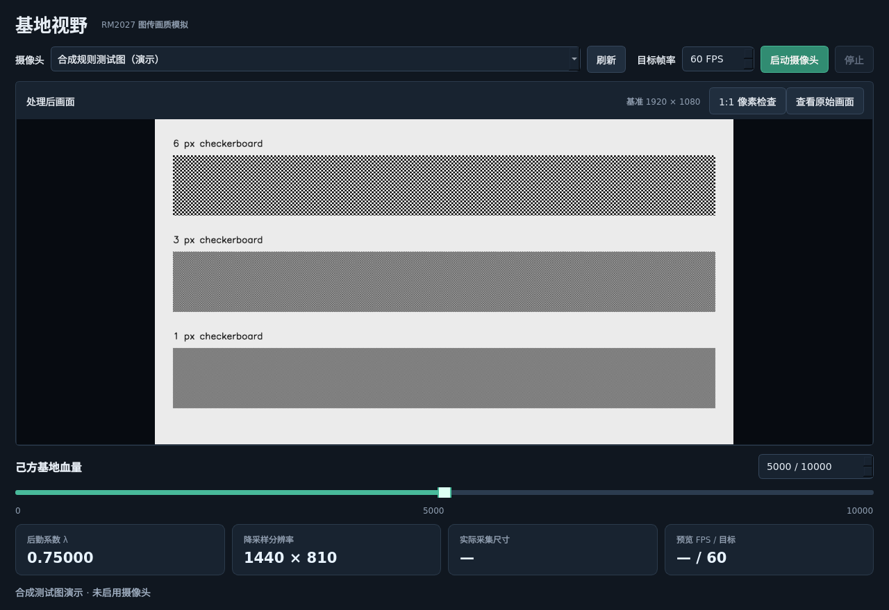
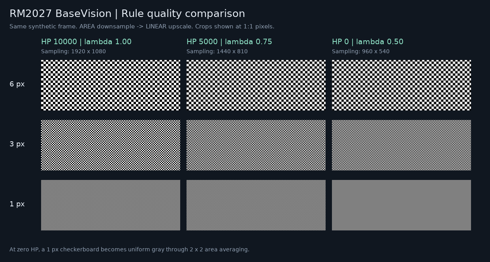

# RM2027 BaseVision

**What does the video feed look like when your base loses HP?**

A C++ desktop camera simulator for testing the **RoboMaster 2027** base-health video-quality rule. Move the HP slider to inspect lost detail, compare the original frame, and examine exact screen pixels.

[中文](README.md) · [Build instructions](docs/BUILDING.md) · [Rule reference](docs/RULES.md) · [Validation](VALIDATION.md) · [MIT license](LICENSE)



## Features

- Live camera input; HP slider and numeric input from 0 to 10000.
- Area-average downsampling followed by bilinear upsampling.
- Original/processed toggle with identical framing.
- Optional 1:1 inspection: one image pixel per physical screen pixel, including HiDPI, with scrolling.
- Target FPS from 1 to 240, default 60, plus measured preview FPS. Repainting an old frame does not count as a new capture.
- Latest-frame mailboxes keep stale frames from accumulating.
- Qt 6 Widgets + OpenCV + CMake. Linux hardware-tested; Windows source and build/deployment scripts provided, not yet tested on Windows.

## Rule

Based on the published **RMUC 2027 Competition Rules V1.0.0 (2026-10-15)**, section 5.6.1, table 5-19 and figure 5-16. [Official rule page](https://bbs.robomaster.com/wiki/20204847/1969149).

```text
lambda = 1 - (10000 - HP) / 20000
sampling size = round(1920 * lambda) x round(1080 * lambda)

1920x1080 baseline -> AREA downsample -> LINEAR upscale to 1920x1080
```

The total pixel count scales by lambda squared; each dimension scales by lambda. At 5000 HP the sampling size is 1440x810; at 0 HP it is 960x540.



This community tool simulates this specific rule. Future official rule revisions may require changes.

## Linux quick start

```bash
sudo apt install git build-essential cmake qt6-base-dev libopencv-dev
git clone https://github.com/mc260/robomaster-2027-vision-simulator.git
cd robomaster-2027-vision-simulator
bash scripts/build-linux.sh
bash scripts/run-linux.sh
```

Select a camera, click start, and try HP 10000 / 5000 / 0. Enable 1:1 inspection to avoid extra smoothing from fitting a full-HD frame inside a smaller window. The UI is currently in Chinese.

For Windows, use the [MSVC x64 build and deployment instructions](docs/BUILDING.md#windows-构建). No Windows runtime verification is claimed yet.

## Reproducible checks

```bash
ctest --test-dir build --output-on-failure
./build/rule_demo build/rule-demo
```

Tests cover endpoint dimensions, rounding, letterboxing, a one-pixel checkerboard, an independent analytic area/bilinear reference, and pixel-identical rendering at 100% and 200% DPI. Standard tests do not open a camera.

## Contribute

Camera compatibility reports, Windows build results and rule-update reports are welcome. If this helps your RM team, a Star helps others discover the project. See [CONTRIBUTING.md](CONTRIBUTING.md).

Source code: MIT. Qt/OpenCV and bundled dependencies retain their own licenses. Rule documents and RoboMaster branding belong to their respective owners.
